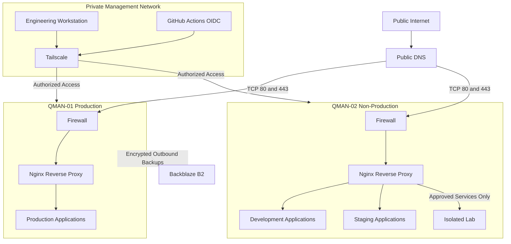

# ADR-003 — Network Architecture

## Metadata

- Decision ID: ADR-003
- Date: 2026-11-24
- Status: Accepted
- Owner: Platform Owner
- Scope: Qman Enterprise Platform
- Classification: Public
- Version: 1.1

## Context

The Qman Enterprise Platform requires secure network
connectivity between production infrastructure,
development environments, staging environments,
experimental workloads, engineering workstations
and automated deployment workflows.

Both Qman servers require public HTTP and HTTPS
connectivity to support web application hosting,
application testing and deployment validation.

Administrative services and internal application
interfaces must remain protected from unauthorized
public access.

The network architecture must provide strong security
controls without introducing unnecessary operational
complexity or infrastructure costs.

## Decision

Use Tailscale as the primary private connectivity
solution for infrastructure administration and
automated deployments.

Allow public HTTP and HTTPS traffic on both QMAN-01
and QMAN-02.

Use Nginx as the public reverse proxy and TLS
termination layer on both servers.

Keep administrative services, databases, application
runtime ports and management interfaces private.

Use identity-based network access policies.

Use a defense-in-depth approach combining provider
firewalls, host firewalls, application binding
and identity-based network policies.

Use GitHub Actions OIDC workload identity federation
for temporary CI/CD network connectivity.

## Architecture Principles

- Private by default
- Default deny
- Least privilege
- Identity-based access
- Defense in depth
- Environment separation
- Encrypted communication
- Controlled public exposure
- Minimal public attack surface
- Reproducible configuration
- Operational simplicity
- Cost efficiency

## Environment Overview

| Server | Environment | Public Services |
|--------|-------------|-----------------|
| QMAN-01 | Production | HTTP and HTTPS |
| QMAN-02 | Development, Staging and Lab | HTTP and HTTPS |

Both servers use Tailscale for private administrative
connectivity.

Public web connectivity does not imply public access
to administrative or internal application services.

## Logical Network Architecture

## Production Network

### QMAN-01

QMAN-01 provides approved public production services.

The initial production application is:

- Notes website (notes.qman.io)

Public inbound services:

- TCP 80 for HTTPS redirection and certificate validation
- TCP 443 for encrypted application traffic

Private administrative services:

- SSH
- Monitoring endpoints
- Deployment interfaces
- Internal application interfaces

Node.js applications must bind to loopback interfaces
unless an explicit architectural requirement exists.

Nginx provides the public reverse proxy and TLS
termination layer.

Database services must not be publicly accessible.

Experimental services must not be deployed directly
on the production server.

## Non-Production Network

### QMAN-02

QMAN-02 provides development, staging and laboratory
services.

Public inbound services:

- TCP 80 for HTTPS redirection and certificate validation
- TCP 443 for approved web applications

Nginx provides the public reverse proxy and TLS
termination layer.

Public connectivity supports:

- Web application development
- Application demonstrations
- Staging validation
- Deployment testing
- Reverse proxy experiments
- TLS certificate management
- Integration testing
- Approved laboratory web applications

Public exposure must be explicitly controlled through
the reverse proxy configuration.

Application services must not be directly exposed
to the public internet.

Development and staging applications containing
sensitive information must require appropriate
authentication and authorization.

Administrative services, databases, monitoring
endpoints and container management interfaces must
remain private.

Laboratory workloads must not have unrestricted
access to production systems.

Development and laboratory applications must not use
production credentials or production application data.

## Network Exposure Matrix

| Service | Protocol | QMAN-01 | QMAN-02 |
|---------|----------|---------|---------|
| HTTP | TCP 80 | Public | Public |
| HTTPS | TCP 443 | Public | Public |
| SSH | TCP 22 | Tailscale only | Tailscale only |
| Node.js | Application-specific | Loopback | Loopback |
| Database | Application-specific | Private | Private |
| Docker API | TCP 2375/2376 | Not installed | Private or disabled |
| Kubernetes API | TCP 6443 | Not installed | Restricted private access |
| Monitoring | Application-specific | Private | Private |
| Administration | Application-specific | Private | Private |

All other inbound application traffic must be denied
unless explicitly authorized.

Infrastructure connectivity required by Tailscale
must be evaluated separately from application
service exposure.

## Public Reverse Proxy Architecture

Nginx will act as the controlled entry point for
public web applications.

Reverse proxy requirements:

- Explicit virtual host configuration
- Approved domain names
- HTTPS enforcement
- Controlled backend routing
- Restricted administrative endpoints
- Secure HTTP headers where appropriate
- Request logging
- Configurable request limits
- Authentication for restricted applications
- No unnecessary information disclosure
- Default rejection of unknown virtual hosts

Backend applications should bind to loopback
interfaces or isolated internal networks.

Applications must not expose their runtime ports
directly to the public internet.

Nginx configuration must be managed through Ansible
and maintained in version control.

Sensitive configuration values must be stored
separately from public configuration repositories.

## Administrative Connectivity

Tailscale provides authenticated private connectivity
for authorized administrators.

Administrative connectivity supports:

- SSH access
- Ansible operations
- Infrastructure management
- Application deployments
- Monitoring access
- Troubleshooting
- Maintenance operations

Administrative access requirements:

- Multi-factor authentication
- Identity-based access policies
- Restricted SSH access
- Dedicated administrative identities
- Device authorization where supported
- Regular access reviews
- Secure credential storage
- Auditable access

Public SSH access must be disabled only after private
administrative connectivity has been successfully
verified.

Provider console access must remain available for
emergency recovery.

## Network Identity

The initial infrastructure identity model is:

| Tag | Purpose |
|-----|---------|
| tag:production | QMAN-01 production infrastructure |
| tag:nonproduction | QMAN-02 non-production infrastructure |
| tag:ci-staging | Staging deployment workloads |
| tag:ci-production | Production deployment workloads |
| tag:monitoring | Authorized monitoring workloads |

Additional tags may be introduced when supported
by documented requirements.

Tag ownership must be restricted to authorized
administrative identities.

Network permissions must be explicitly defined
using Tailscale Grants.

Existing permissive access rules must be reviewed
before the target network policy is activated.

Network policies must follow least privilege
principles.

## Private Network Access Matrix

| Source | Production | Non-Production |
|--------|------------|----------------|
| Authorized administrator | Allowed | Allowed |
| CI staging identity | Denied | Restricted deployment |
| CI production identity | Restricted deployment | Denied |
| Monitoring identity | Approved endpoints | Approved endpoints |
| Lab workloads | Denied | Restricted |
| Public internet | HTTP and HTTPS only | HTTP and HTTPS only |

Access to publicly approved web applications remains
possible independently of private network permissions.

Private network permissions must not grant unrestricted
host-level administrative access.

## Workload Identity Federation

GitHub Actions will use OpenID Connect workload
identity federation to establish temporary
Tailscale connectivity.

Requirements:

- No permanent Tailscale authentication keys in GitHub
- Short-lived workload identities
- Repository-specific identity restrictions
- Environment-specific deployment permissions
- Restricted network destinations and ports
- Explicit production deployment authorization
- Full commit SHA pinning for third-party Actions
- Auditable deployment workflows

Staging deployment identities must not have private
administrative access to production infrastructure.

Production deployment identities must only receive
the permissions required to deploy approved
application artifacts.

Network authentication does not replace host-level
authentication or application authorization.

Host-level deployment authentication must be
defined in the deployment and identity architecture.

## Firewall Architecture

The platform will use layered firewall controls.

### Provider Firewall

Where supported, provider firewalls will restrict
public inbound traffic.

The initial public application firewall policy is:

- Allow TCP 80
- Allow TCP 443
- Deny all other unsolicited inbound application traffic

Additional infrastructure connectivity must be
explicitly justified.

Provider-specific firewall capabilities must be
validated before implementation.

### Host Firewall

UFW will provide the initial Linux host firewall
configuration.

Host firewall requirements:

- Default deny inbound traffic
- Explicitly authorized public services
- Restricted administrative access
- IPv4 and IPv6 coverage
- Version-controlled configuration
- Automated configuration through Ansible
- Controlled firewall changes
- Emergency recovery procedures

Public HTTP and HTTPS traffic will be permitted
on both QMAN-01 and QMAN-02.

SSH access will be permitted through the authorized
Tailscale interface.

Tailscale network policies and its Linux firewall
integration must be evaluated together with UFW.

Effective network exposure must be independently
verified after configuration changes.

Outbound traffic will initially be permitted where
required for platform operations.

More restrictive outbound policies may be introduced
based on workload requirements.

### Container Firewall

Container port publishing must be explicitly controlled.

Docker-managed firewall rules can bypass ordinary
UFW filtering.

Container network exposure must therefore be verified
independently.

Container workloads must not publish services on
public interfaces without explicit authorization.

Where possible, container applications must use
loopback bindings or isolated internal networks.

Nginx will provide controlled public access to
approved containerized web applications.

### Kubernetes Network Security

Kubernetes will initially be introduced only within
the QMAN-02 laboratory environment.

Requirements:

- Restricted Kubernetes API access
- Controlled ingress configuration
- Network policies where supported
- Namespace isolation
- Resource limits
- Restricted administrative identities
- No unrestricted production connectivity
- No uncontrolled public NodePort services
- No production credentials in laboratory workloads

Kubernetes network architecture must be validated
before public laboratory services are introduced.

## DNS Architecture

Public DNS records will identify approved public
web applications.

Initial production service:

- notes.qman.io

Potential non-production naming conventions:

- dev.qman.io
- staging.qman.io
- lab.qman.io

Additional application-specific subdomains may
be introduced when required.

The final DNS naming convention must be reviewed
before DNS records are created.

Tailscale MagicDNS will provide private infrastructure
name resolution where appropriate.

DNS requirements:

- Controlled DNS changes
- Restricted administrative access
- Minimal public infrastructure disclosure
- Documented DNS records
- DNSSEC where supported
- Separate public and private service resolution
- Removal of obsolete DNS records

Sensitive infrastructure inventories must not be
published in public repositories.

## TLS Architecture

All approved public web applications must use HTTPS.

Public HTTP services must redirect to HTTPS,
except where required for certificate validation.

TLS certificates will initially be provided by
Let's Encrypt.

Certificate management must support:

- Automated issuance
- Automated renewal
- Expiration monitoring
- Restricted private key access
- Modern TLS configuration
- Documented certificate ownership
- Automated deployment where appropriate

Public development and staging applications must
follow the same baseline TLS requirements as
production applications.

TLS configuration must be managed consistently
through reusable Ansible roles.

## Outbound Connectivity

Infrastructure requires controlled outbound connectivity
for platform operations.

Approved outbound dependencies include:

- Operating system package repositories
- Security update repositories
- GitHub
- Tailscale
- Backblaze B2
- DNS resolution
- Time synchronization
- Certificate authorities
- Approved application dependencies
- Approved container registries

All external service communication must use encrypted
transport where supported.

Outbound connectivity requirements must be reviewed
periodically.

Laboratory workloads must not receive unrestricted
access to private production services.

## Backup Network Connectivity

Backup architecture is defined in ADR-001.

Restic will connect to Backblaze B2 using encrypted
outbound HTTPS connections.

Backup network requirements:

- No public inbound backup services
- Encrypted transport
- Client-side encryption
- Environment-specific credentials
- Restricted backup repository access
- Verified connectivity
- Monitoring of backup failures

Production backup credentials must not be available
to development or laboratory workloads.

## Trust Domain Separation

Qman and Talland infrastructure must remain separate
administrative and security trust domains.

The target architecture uses independent tailnets,
network policies and administrative identities.

The following must remain separated:

- Administrative identities
- Workload identities
- Network access policies
- Infrastructure inventories
- SSH credentials
- Deployment credentials
- Backup credentials
- Private DNS configuration

Cross-domain connectivity requires explicit
organizational authorization and documented
justification.

No subnet routing between trust domains will be
enabled by default.

Talland infrastructure must comply with applicable
organizational security policies.

## Network Routing

Subnet routing and exit node functionality will not
be enabled unless required by a documented use case.

IP forwarding must remain disabled where it is
not required.

Container and Kubernetes workloads may require IP
forwarding within QMAN-02.

Such requirements must be explicitly configured
and validated.

Production infrastructure must not depend on
non-production routing services.

Laboratory routing changes must not compromise
staging or production connectivity.

## Emergency Access

Emergency infrastructure access must remain available
independently of Tailscale.

The recovery procedure must include:

- VPS provider console access
- Verified provider account access
- Multi-factor authentication
- Securely stored recovery information
- Firewall recovery procedures
- SSH configuration recovery procedures
- Tailscale connectivity recovery procedures

Administrative access must be verified before
public SSH access is disabled.

Emergency access procedures must be documented
and periodically tested.

## Monitoring and Auditing

Network monitoring must eventually provide visibility
into:

- Public service availability
- Private service availability
- Unexpected listening ports
- Firewall configuration drift
- Unauthorized access attempts
- Network policy changes
- TLS certificate expiration
- Private connectivity failures
- DNS resolution failures
- Unexpected container port exposure
- Reverse proxy errors

Network configuration must be reviewed periodically.

External availability checks should validate approved
public web applications.

Private monitoring endpoints must not be exposed
directly to the public internet.

## Configuration Management

Network configuration must be reproducible.

Ansible will manage:

- UFW configuration
- Nginx installation
- Nginx virtual hosts
- TLS configuration
- SSH configuration
- Tailscale installation and host configuration
- Network-related operating system settings

Terraform will manage provider-level network
resources where supported.

Version-controlled configuration must distinguish
between production and non-production environments.

Secrets and sensitive environment-specific values
must not be stored in public GitHub repositories.

## Alternatives Considered

### Public SSH Access

Advantages:

- Simple remote connectivity
- No private network dependency

Disadvantages:

- Increased public attack surface
- Additional authentication risks
- Greater exposure to automated attacks

Decision: Not selected.

### Traditional VPN

Advantages:

- Controlled private connectivity
- Established technology

Disadvantages:

- Additional infrastructure requirements
- Manual routing and key management
- Increased operational complexity

Decision: Not selected.

### Self-Hosted WireGuard

Advantages:

- Direct control
- Lightweight implementation
- No external coordination service requirement

Disadvantages:

- Additional identity and key management
- More manual configuration
- Additional operational responsibility

Decision: Deferred.

### Tailscale

Advantages:

- Identity-based private connectivity
- Encrypted communication
- Centralized network access policies
- GitHub Actions integration
- Workload identity federation
- Limited operational complexity

Disadvantages:

- External coordination service dependency
- Provider-specific identity and policy configuration
- Dependency on applicable subscription capabilities

Decision: Selected.

### Private-Only Non-Production Environment

Advantages:

- Reduced public attack surface
- Simplified access restrictions

Disadvantages:

- Limited external application demonstrations
- Reduced flexibility for public integration testing
- Limited validation of public DNS and TLS workflows

Decision: Not selected.

QMAN-02 will support approved public web applications
through Nginx while administrative and internal
application services remain private.

## Known Risks

| Risk | Mitigation |
|------|------------|
| Tailscale connectivity failure | Independent provider console access |
| Overly permissive network policies | Policy validation and access reviews |
| Accidental administrative lockout | Validate private access before firewall changes |
| Unauthorized CI/CD connectivity | Restricted federated identities |
| Docker bypasses host firewall policy | Explicit container firewall validation |
| IPv6 exposure | Validate IPv4 and IPv6 firewall policies |
| Compromised lab workloads | Restrict private production access |
| Public staging vulnerabilities | Authentication, patching and controlled exposure |
| Accidental exposure of development data | Environment separation and access controls |
| Configuration drift | Ansible and automated compliance checks |
| Certificate expiration | Automated renewal and monitoring |
| DNS configuration errors | Controlled DNS changes and validation |
| Public application abuse | Application security controls and request limits |

## Current Limitations

- Existing network policies have not yet been audited.
- Target firewall configurations are not yet implemented.
- Workload identity federation is not yet configured.
- Host-level deployment authentication is not yet defined.
- Provider firewall capabilities require validation.
- Separate trust domain connectivity requires verification.
- Container network isolation is not yet implemented.
- Kubernetes network architecture is not yet implemented.
- Network monitoring is not yet operational.
- Non-production DNS names have not yet been finalized.
- Public application exposure has not yet been independently
  verified.
- Applicable Tailscale subscription capabilities require
  validation.

These limitations must be addressed during the relevant
implementation phases.

## Implementation Roadmap

1. Inventory existing Tailscale configuration.
2. Verify administrative identities and MFA.
3. Validate trust domain separation.
4. Define infrastructure tags.
5. Configure identity-based network grants.
6. Validate private network access restrictions.
7. Establish provider console recovery access.
8. Implement the Linux firewall baseline.
9. Enable approved public HTTP and HTTPS connectivity.
10. Verify IPv4 and IPv6 exposure.
11. Configure public and private DNS.
12. Establish the Nginx reverse proxy baseline.
13. Implement TLS certificate management.
14. Configure GitHub Actions workload identity federation.
15. Validate staging deployment connectivity.
16. Validate production deployment connectivity.
17. Implement network compliance checks.
18. Establish network monitoring.
19. Validate container network isolation.
20. Validate Kubernetes network isolation.

## Acceptance Criteria

- [ ] Administrative connectivity uses Tailscale.
- [ ] Public SSH access is disabled.
- [ ] Emergency console access is verified.
- [ ] QMAN-01 supports public HTTP and HTTPS.
- [ ] QMAN-02 supports public HTTP and HTTPS.
- [ ] Public web traffic is controlled through Nginx.
- [ ] Unknown virtual hosts are rejected.
- [ ] Internal application ports are not publicly accessible.
- [ ] Database services are not publicly accessible.
- [ ] Administrative endpoints remain private.
- [ ] Sensitive staging applications require authentication.
- [ ] IPv4 and IPv6 exposure is verified.
- [ ] Environment-specific network identities are configured.
- [ ] Network access policies are validated.
- [ ] Unauthorized private lab access to production is blocked.
- [ ] GitHub Actions uses temporary workload identities.
- [ ] Staging identities cannot access private production services.
- [ ] DNS configuration is documented.
- [ ] TLS certificate issuance and renewal are operational.
- [ ] Firewall configuration is managed through Ansible.
- [ ] Reverse proxy configuration is managed through Ansible.
- [ ] Container network exposure is verified before deployment.
- [ ] Kubernetes network exposure is verified before deployment.
- [ ] Network monitoring is operational.
- [ ] Qman and Talland trust domains remain separated.

## Consequences

The selected architecture provides a consistent
network security baseline for both production and
non-production infrastructure.

Both Qman servers support public web application
hosting while administrative connectivity remains
restricted to authorized private network access.

QMAN-02 supports public application demonstrations,
staging validation and controlled experimentation.

Public exposure of non-production applications
introduces additional security responsibilities.

Development and staging applications must therefore
receive appropriate authentication, patching,
monitoring and exposure controls.

Administrative connectivity depends on Tailscale
availability and correct access policy configuration.

Emergency recovery access must be maintained
independently.

Network changes must be validated before being
applied to production infrastructure.

The architecture avoids unnecessary infrastructure
and additional cloud networking services.

## Review Policy

Review this decision:

- Quarterly
- After a network security incident
- After significant infrastructure changes
- Before introducing new public services
- Before introducing container orchestration
- When identity or access requirements change
- When network isolation requirements increase
- When infrastructure providers change

## Related Architecture Decision Records

- ADR-001 — Backup Storage Architecture
- ADR-002 — Environment Separation

Planned architecture decisions:

- ADR-004 — Deployment Architecture
- ADR-005 — Security Architecture

## References

- https://tailscale.com/docs/
- https://docs.github.com/en/actions
- https://docs.docker.com/engine/network/packet-filtering-firewalls/
- https://kubernetes.io/docs/concepts/services-networking/
- https://letsencrypt.org/docs/
- https://nginx.org/en/docs/
- https://docs.ansible.com/
- https://documentation.ubuntu.com/server/

## Revision History

| Version | Date | Description |
|---------|------|-------------|
| 1.0 | 2026-11-24 | Initial network architecture decision |
| 1.1 | 2026-11-24 | Public HTTP and HTTPS enabled for both Qman servers |

---

Qman Enterprise Platform

Secure by design. Automated by default.

