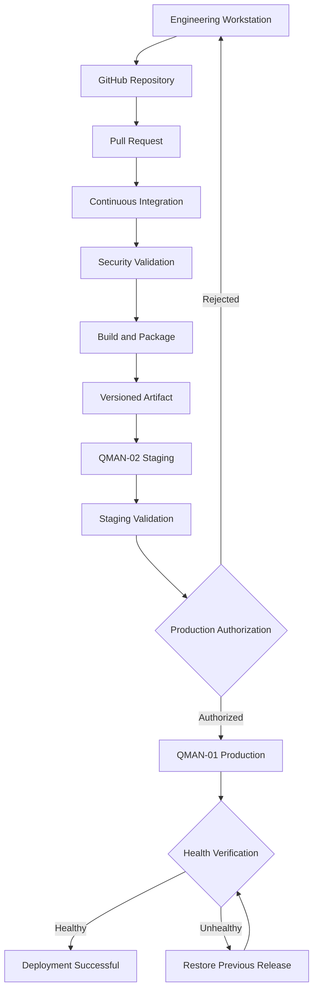

# ADR-004 — Deployment Architecture

## Metadata

- Decision ID: ADR-004
- Date: 2026-11-24
- Status: Accepted
- Owner: Platform Owner
- Scope: Qman Enterprise Platform
- Classification: Public
- Version: 1.0

## Context

The Qman Enterprise Platform requires a secure,
automated and reproducible application deployment
architecture.

Application source code is maintained in GitHub.

The platform consists of separate production and
non-production environments as defined in ADR-002.

Network connectivity and administrative access are
defined in ADR-003.

Manual application deployments introduce operational
risks, configuration drift and inconsistent releases.

The deployment architecture must support controlled
application delivery, security validation, release
traceability and reliable rollback procedures.

The architecture must remain proportionate to the
initial platform size and operational requirements.

## Decision

Use GitHub Actions as the primary continuous
integration and continuous delivery platform.

Adopt a build-once, deploy-many release strategy.

Deploy immutable, versioned application artifacts
to staging before promoting the same artifacts
to production.

Use Tailscale for private deployment connectivity.

Use OpenID Connect workload identity federation
for temporary network authentication.

Use dedicated deployment identities for host-level
authentication and authorization.

Use Ansible for infrastructure and application
runtime configuration.

Use systemd for initial application process
management.

Use Nginx as the public reverse proxy and TLS
termination layer.

Container orchestration will be introduced only
when supported by documented architectural
requirements.

## Architecture Principles

- Automation first
- Security by design
- DevSecOps
- Build once, deploy many
- Immutable release artifacts
- Separation of environments
- Least privilege
- Reproducible deployments
- Traceable changes
- Explicit production authorization
- Fast and reliable rollback
- Operational simplicity
- Cost efficiency

## Environment Overview

| Environment | Infrastructure | Deployment Purpose |
|-------------|----------------|--------------------|
| Local | Engineering workstation | Development and testing |
| Development | QMAN-02 | Integration and development |
| Staging | QMAN-02 | Release validation |
| Lab | QMAN-02 | Technology experimentation |
| Production | QMAN-01 | Approved production releases |

Production deployments must not depend on the
availability of development or laboratory workloads.

Laboratory deployment experiments must not modify
production infrastructure or production credentials.

## Logical Deployment Architecture

## Source Control

GitHub is the authoritative source for application
source code, infrastructure definitions and
configuration management.

Source control requirements:

- Version-controlled application source code
- Protected main branches
- Pull request-based changes
- Automated validation
- Traceable commits
- Documented release versions
- Restricted repository administration
- Controlled workflow modifications
- Secure dependency management

Production source code must not be modified directly
on production servers.

Emergency changes must be documented and reconciled
with the authoritative source repository.

## Branching Strategy

Use a lightweight trunk-based development model.

The initial branching model consists of:

- main
- feature/*
- fix/*
- chore/*
- docs/*

Changes should be developed in short-lived branches.

The main branch must represent a validated and
potentially releasable application state.

Long-lived environment-specific branches should
be avoided.

Environment differences must be managed through
configuration rather than divergent application
source code.

Squash merging will be used where appropriate to
maintain a clear and manageable commit history.

## Continuous Integration

Every application repository must implement
appropriate automated validation.

The initial continuous integration pipeline includes:

1. Source code checkout
2. Runtime initialization
3. Dependency installation
4. Code formatting validation
5. Linting
6. Unit testing
7. Integration testing where applicable
8. Dependency vulnerability scanning
9. Secret scanning
10. Application build validation

Failed mandatory checks must block release
promotion.

CI validation must not require access to production
infrastructure or production credentials.

Untrusted pull request workflows must not receive
deployment credentials or private network access.

GitHub-hosted runners will initially be used
to reduce infrastructure maintenance requirements.

## Dependency Management

Application dependencies must be reproducible
and version-controlled.

For Node.js applications:

- Maintain package.json in source control.
- Maintain package-lock.json in source control.
- Use npm ci for reproducible dependency installation.
- Pin the supported Node.js runtime version.
- Review dependency updates.
- Monitor known security vulnerabilities.
- Use Dependabot where appropriate.

Dependency installation must occur during the
controlled build process.

Production deployments must not depend on
uncontrolled dependency resolution.

Runtime dependencies must be included in the
release artifact where required.

Platform-specific dependencies must be built for
the target operating system and CPU architecture.

## Build Architecture

Application builds must execute in a controlled
and reproducible build environment.

Build requirements:

- Defined runtime versions
- Locked application dependencies
- Version-controlled build instructions
- Explicit build environment configuration
- Automated build validation
- Traceable build outputs
- No embedded production credentials
- No environment-specific secrets

Build-time configuration must not prevent promotion
of the same artifact between environments.

Environment-specific application configuration
should be injected at runtime.

Where an application requires environment-specific
build configuration, the limitation must be
documented and reviewed.

## Release Artifacts

Every deployable release must produce an identifiable
and immutable application artifact.

The initial artifact format will be a compressed
application archive.

A release artifact should contain:

- Application build output
- Required runtime dependencies
- Release metadata
- Version information
- Source commit identifier
- Software Bill of Materials where applicable
- Integrity verification information

Example release files:

    notes-1.0.0-linux-amd64.tar.gz
    notes-1.0.0-linux-amd64.tar.gz.sha256
    notes-1.0.0-sbom.cdx.json
    release-metadata.json

Release metadata must identify:

- Application name
- Release version
- Git commit SHA
- Build timestamp
- Build workflow run
- Target operating system
- Target CPU architecture
- Runtime version
- Artifact checksum

Artifacts must not contain:

- Application secrets
- SSH private keys
- Production environment files
- Backup credentials
- Infrastructure credentials
- Customer information
- Unnecessary development dependencies

## Artifact Integrity and Provenance

Each release artifact must have a SHA-256 checksum.

Artifact integrity must be verified before deployment.

Expected artifact digests must be obtained from
trusted release metadata.

Checksums provide corruption detection but do not
independently establish artifact authenticity.

Artifact signing and build provenance should be
introduced when supported by the repository
configuration and applicable platform capabilities.

The deployment process must establish a traceable
relationship between:

- Source commit
- Build workflow
- Release artifact
- Staging validation
- Production authorization
- Production deployment

Release artifacts must never be silently replaced
after validation.

## Artifact Storage

GitHub Actions Artifacts will initially be used for
temporary build artifact storage.

GitHub Releases may be used for longer-term
distribution of approved release artifacts.

Artifact storage must support:

- Version identification
- Controlled access
- Integrity verification
- Defined retention periods
- Release traceability
- Deployment reproducibility

Initial temporary artifact retention:

- Build artifacts: 14 days
- CI evidence: 30 days where supported

These retention periods are proposed defaults and
must be reviewed during implementation.

Approved production releases must remain available
for the required rollback and disaster recovery
period.

Long-term retention must not depend exclusively on
temporary GitHub Actions artifacts.

Artifacts must only be published publicly when
their contents are suitable for public distribution.

## Release Versioning

Application releases will use Semantic Versioning
where appropriate.

The version format is:

    MAJOR.MINOR.PATCH

Example versions:

    1.0.0
    1.1.0
    1.1.1

Git commit identifiers must also be recorded.

Development builds may use commit-based identifiers.

Release identifiers must be unique and immutable.

Rebuilding an existing release must not silently
replace its original artifact.

Release tags must be controlled and protected
where supported.

## Continuous Delivery

The continuous delivery workflow prepares validated
application releases for deployment.

The deployment sequence is:

1. Complete mandatory CI checks.
2. Build the application artifact.
3. Generate release metadata.
4. Generate artifact checksums.
5. Store the release artifact.
6. Establish temporary staging connectivity.
7. Deploy the artifact to staging.
8. Perform staging health checks.
9. Record staging validation results.
10. Request production authorization.
11. Establish temporary production connectivity.
12. Deploy the same verified artifact to production.
13. Perform production health checks.
14. Record deployment results.
15. Execute rollback if required.

Production deployment must not rebuild the
application artifact.

## Staging Deployment

Staging deployments will execute on QMAN-02.

Staging must use a production-like application
runtime and deployment procedure.

Staging validation should include:

- Artifact integrity verification
- Application startup verification
- Runtime compatibility
- HTTP response validation
- Health endpoint validation
- Configuration validation
- Reverse proxy validation
- TLS validation where applicable
- Application smoke tests
- Database compatibility where applicable

Staging must use environment-specific configuration
and credentials.

Production credentials must not be available to
staging workloads.

Staging applications containing sensitive data must
require appropriate authentication.

A failed staging deployment must block production
promotion.

## Production Deployment

Production deployments will execute on QMAN-01.

Only artifacts that have successfully completed
staging validation may be promoted to production.

Production deployment requirements:

- Explicit release authorization
- Verified release identity
- Artifact checksum validation
- Environment-specific configuration
- Dedicated deployment identity
- Controlled service restart
- Post-deployment health checks
- Deployment logging
- Rollback capability

Production deployments must not use:

- Manual Git pulls
- Direct source code editing
- Uncontrolled dependency installation
- Unreviewed deployment scripts
- Shared staging credentials
- Unverified release artifacts

## Production Authorization

Production deployment must require an explicit
authorization decision.

GitHub deployment environments and protection rules
will be used where supported.

The intended environment names are:

    development
    staging
    production

Production authorization must identify the exact
release artifact and its verified staging results.

The initial platform operates with a single
maintainer.

Independent four-eyes approval is therefore not
currently achievable.

Explicit maintainer authorization is accepted as
an initial compensating control.

Where GitHub environment protection features are
unavailable, production deployment may use a
dedicated manually triggered workflow restricted
to trusted release references.

This alternative must be reviewed to ensure that
untrusted workflows cannot access deployment
credentials or production network identities.

Manual workflow execution must not bypass staging
validation or artifact integrity verification.

Independent approval requirements must be reviewed
when additional maintainers or customer production
workloads are introduced.

## Deployment Connectivity

Private deployment connectivity is defined in ADR-003.

GitHub Actions will establish temporary Tailscale
connectivity through workload identity federation.

Deployment connectivity requirements:

- Short-lived network identities
- Repository-specific identity restrictions
- Environment-specific network permissions
- Restricted destination servers
- Restricted destination ports
- No permanent Tailscale authentication keys
- No unrestricted access to the private network

Initial deployment network identities:

| Identity | Destination |
|----------|-------------|
| tag:ci-staging | QMAN-02 |
| tag:ci-production | QMAN-01 |

The staging identity must not have private
administrative access to production infrastructure.

The production identity must only receive the
network permissions required for deployment.

Network connectivity must terminate when the
deployment workflow completes.

## Host-Level Authentication

Private network access does not automatically grant
host-level authorization.

Dedicated deployment accounts will be used for
application deployment.

The proposed initial account names are:

    deploy-notes

Accounts with the same logical name may exist in
multiple environments but must use independently
scoped credentials and permissions.

Host authentication may initially use dedicated
environment-specific SSH keys.

Short-lived SSH authentication should be evaluated
as the identity architecture matures.

Host authentication requirements:

- Dedicated deployment accounts
- No direct root login
- No shared personal credentials
- No unrestricted sudo access
- Environment-specific authentication
- Verified SSH host identity
- Secure credential storage
- Credential rotation
- Auditable access

SSH host key verification must remain enabled.

The final authentication mechanism will be
implemented during the identity and access
management phase.

## Deployment Authorization on Hosts

Deployment accounts must only have access to the
resources necessary for their application.

The deployment account may require permission to:

- Upload an approved release artifact.
- Verify release integrity.
- Invoke a controlled deployment procedure.
- Activate an approved application release.
- Request a controlled application restart.
- Retrieve deployment status.

Deployment accounts must not have unrestricted
administrative permissions.

Privileged deployment operations must execute
through narrowly scoped, root-owned procedures.

Deployment scripts and systemd unit definitions
must not be writable by application runtime users
or unprivileged deployment accounts.

Archive extraction must validate archive contents
and prevent unsafe filesystem paths, symlinks
and permission escalation.

## Application Filesystem Layout

Use a consistent application directory structure.

Example for Notes:

    /opt/qman/apps/notes/
        releases/
            1.0.0/
            1.1.0/
            1.2.0/
        current -> releases/1.2.0
        shared/

    /etc/qman/notes/
        notes.env

    /var/lib/qman/notes/

    /var/cache/qman/notes/

Directory responsibilities:

| Directory | Purpose |
|-----------|---------|
| releases | Immutable application releases |
| current | Reference to the active release |
| shared | Explicitly approved shared resources |
| /etc/qman/notes | Application configuration |
| /var/lib/qman/notes | Persistent application data |
| /var/cache/qman/notes | Reproducible cache data |

Release directories must not contain mutable
application data.

Application runtime users must not be able to
modify deployed release files.

Persistent application data must survive
application upgrades and rollbacks.

## Application Runtime

Node.js will be the initial application runtime.

Runtime versions must be explicitly defined and
maintained through configuration management.

Production and staging must use compatible
runtime versions.

Runtime requirements:

- Supported runtime versions
- Regular security updates
- Dedicated application service accounts
- Explicit environment configuration
- Restricted filesystem permissions
- Restricted listening interfaces
- Controlled resource utilization

The application runtime account must be separate
from the deployment account.

## Process Management

Systemd will provide initial application process
management.

PM2 will not be part of the initial target
deployment architecture.

Systemd responsibilities:

- Application startup
- Application shutdown
- Controlled service restart
- Automatic startup after reboot
- Failure recovery
- Runtime environment configuration
- Resource management
- Service status reporting
- Integration with the system journal

Systemd units must be managed through Ansible.

Application services must run without root
privileges unless an explicitly documented
requirement exists.

Appropriate systemd hardening options must be
evaluated and implemented.

## Reverse Proxy Integration

Nginx will provide the public reverse proxy layer.

Application deployments should not require
unnecessary reverse proxy configuration changes.

Nginx responsibilities:

- HTTP and HTTPS connectivity
- TLS termination
- Backend routing
- Request logging
- Request limits where appropriate
- Approved security headers
- Controlled public application exposure

Nginx configuration must be validated before
reload or restart.

Network exposure requirements are defined in
ADR-003.

Application runtime ports must not be directly
exposed to the public internet.

## Configuration Management

Infrastructure and application runtime configuration
must be separated from application releases.

Terraform will manage infrastructure resources
where supported.

Ansible will manage:

- Operating system configuration
- Application runtime installation
- Service accounts
- Deployment accounts
- Directory structure
- Filesystem permissions
- Systemd services
- Nginx configuration
- Firewall configuration
- Backup integration
- Monitoring integration

Application deployment workflows must not perform
uncontrolled infrastructure changes.

Infrastructure changes and application releases
must remain independently traceable.

## Application Configuration

Application configuration must be environment-specific.

Configuration may include:

- Application listening port
- Public application URL
- Logging level
- Feature flags
- Database connection configuration
- External service configuration
- Environment identification

Non-sensitive configuration should be version-controlled.

Sensitive configuration must be stored and managed
separately.

The same application artifact must support staging
and production configuration without rebuilding
where technically feasible.

## Secrets Management

Secrets must never be committed to source control
or included in release artifacts.

Secrets may initially be managed through:

- GitHub Actions Secrets
- GitHub Environment Secrets where supported
- Ansible Vault
- Restricted server-side configuration files
- Secure workstation credential storage

Production and staging secrets must be separated.

Secrets management requirements:

- Least privilege
- Restricted file permissions
- Credential rotation
- No secrets in deployment logs
- No secrets in release metadata
- No secrets in public repositories
- Documented recovery procedures
- Restricted access to secret decryption credentials

Long-lived credentials must be minimized.

A dedicated external secrets management platform
will only be introduced when justified by
documented requirements.

## Deployment Procedure

The application deployment procedure must be
deterministic and repeatable.

The intended procedure is:

1. Validate deployment parameters.
2. Acquire an application deployment lock.
3. Verify the target environment.
4. Verify available disk space.
5. Retrieve the approved release artifact.
6. Verify artifact integrity.
7. Validate archive contents.
8. Extract into a new release directory.
9. Apply appropriate ownership and permissions.
10. Validate application configuration.
11. Record the previously active release.
12. Atomically update the current symlink.
13. Restart the application service.
14. Wait for application readiness.
15. Execute health and smoke tests.
16. Record the deployment outcome.
17. Roll back when validation fails.
18. Release the deployment lock.

The existing active release must not be modified
during artifact preparation.

Incomplete deployments must not become active.

Deployment operations must be serialized to prevent
concurrent modifications of the same application.

## Health Checks

Every production application must provide a
defined health verification mechanism.

The preferred initial approach is an HTTP health
endpoint where supported by the application.

Example endpoint:

    /health

Health verification may include:

- Service process status
- Application startup status
- HTTP response status
- Expected response content
- Runtime readiness
- Required dependency availability
- Reverse proxy connectivity

Health checks must use bounded timeouts.

A running process alone does not establish that
an application is operational.

Health endpoints must not expose sensitive
configuration or internal operational details.

Public and private health endpoints must be
appropriately separated where necessary.

## Rollback Strategy

Application deployments must support rollback
to a previously validated release.

The rollback mechanism will initially use
versioned release directories and an atomic
current symlink update.

Rollback procedure:

1. Identify the previous validated release.
2. Verify that the previous release is available.
3. Activate the previous release.
4. Restart the application service.
5. Perform health verification.
6. Record the rollback result.
7. Escalate if recovery is unsuccessful.

Automatic rollback may be performed when
post-deployment validation fails and the previous
release remains compatible with persistent data.

Failed releases must not automatically be
redeployed without further investigation.

Rollback capability must be tested before
production deployment automation is accepted.

## Database Changes

Database changes introduce additional deployment
and rollback risks.

Applications requiring database migrations must
define a migration strategy.

Database migration requirements:

- Version-controlled migrations
- Staging validation
- Compatibility assessment
- Application-consistent backups when required
- Explicit authorization for destructive changes
- Documented recovery procedures
- Data integrity verification

Backward-compatible schema changes are preferred.

Expand-and-contract migration patterns should be
used where appropriate.

Application rollback does not automatically
reverse database schema or data changes.

Destructive database migrations must not rely on
application rollback as the sole recovery mechanism.

## Release Retention

Previous application releases must remain
available for rollback.

The proposed initial server-side retention
policy is:

- Current active release
- Three previously validated releases
- Additional releases when explicitly required

Release cleanup must not remove:

- The active release
- The selected rollback release
- Releases required for an active deployment
- Releases retained for incident investigation

Retention automation must validate release
references before deleting files.

Retention settings must be reviewed based on
available disk space and recovery requirements.

## Backup and Disaster Recovery

Backup storage and recovery requirements are
defined in ADR-001.

Application source code and build artifacts must
be managed independently from persistent
application data.

Production backups must prioritize:

- Persistent application data
- Required application configuration
- Database contents
- Critical recovery information

Reproducible application builds and dependencies
do not require routine backup when reliable
release recovery is available.

Recovery procedures must support:

1. Reprovisioning infrastructure.
2. Reapplying configuration through Ansible.
3. Restoring required persistent data.
4. Retrieving a validated application release.
5. Deploying the application artifact.
6. Verifying application functionality.

Production infrastructure must not be destroyed
until required data has been reviewed, protected
and recovery has been verified.

## DevSecOps Controls

Security controls must be integrated throughout
the deployment lifecycle.

Initial security controls:

- Branch protection
- Mandatory CI validation
- Dependency vulnerability scanning
- Secret scanning
- Restricted GitHub Actions permissions
- Trusted third-party Actions
- Full commit SHA pinning
- Artifact integrity verification
- Workload identity federation
- Environment-specific deployment identities
- Explicit production authorization
- Deployment audit logging

Workflow tokens must use the minimum permissions
required for each job.

OIDC token issuance permissions must only be
granted to jobs requiring federated authentication.

Third-party Actions must be reviewed before use.

Untrusted contributions must not execute in a
privileged deployment context.

Security exceptions must be documented, approved
and periodically reviewed.

## Software Bill of Materials

Release workflows should generate a Software Bill
of Materials where applicable.

The preferred initial SBOM format is CycloneDX.

The SBOM should identify:

- Application dependencies
- Dependency versions
- Component identifiers
- Dependency relationships where supported

SBOMs must be associated with their corresponding
release artifacts.

SBOM contents must be reviewed before public
publication.

SBOM generation and vulnerability scanning tools
will be selected during implementation.

## Vulnerability Management

Application and infrastructure vulnerabilities
must be monitored throughout the platform lifecycle.

Vulnerability management includes:

- Dependency scanning
- Operating system security updates
- Runtime security updates
- Container image scanning when applicable
- Periodic dependency reviews
- Security advisory monitoring
- Documented remediation decisions

Release blocking criteria must consider severity,
exploitability and application exposure.

Known exploitable critical vulnerabilities must
block deployment unless an explicitly approved
security exception exists.

Security policy and remediation timelines will
be defined separately.

## Observability

Deployment operations must produce sufficient
operational evidence.

Required deployment information:

- Application name
- Environment
- Release version
- Source commit SHA
- Artifact digest
- Deployment start time
- Deployment completion time
- Deployment identity
- Authorization record
- Health verification result
- Rollback status

Application logs will initially be available
through systemd journal integration.

Centralized logging and monitoring will be
introduced during the observability phase.

Deployment events must eventually be correlated
with application health, incidents and monitoring
alerts.

## Deployment Metrics

The platform should progressively collect
software delivery performance metrics.

Initial metrics:

- Deployment frequency
- Change lead time
- Change failure rate
- Failed deployment recovery time
- Deployment duration
- Rollback frequency
- Successful deployment rate

Metrics must support continuous improvement
rather than individual performance evaluation.

Metric definitions and collection methods must
be documented before trends are interpreted.

## Failure Handling

Deployment failures must leave the application
in a recoverable state.

Failure scenarios include:

- Artifact download failure
- Checksum verification failure
- Invalid application configuration
- Insufficient disk space
- Service startup failure
- Failed health checks
- Network connectivity failure
- Failed database migration
- Concurrent deployment conflicts
- Rollback failure

Failure handling requirements:

- Stop unsafe deployment operations.
- Preserve the existing active release where possible.
- Record the failure reason.
- Prevent uncontrolled retry loops.
- Execute rollback where safe.
- Notify the authorized maintainer.
- Preserve relevant diagnostic evidence.

A rollback failure must be treated as an
operational incident.

## Container and GitOps Evolution

The initial deployment architecture does not
require containers or Kubernetes.

Container-based deployments may later be
introduced on QMAN-02.

Potential technologies include:

- Docker
- OCI container images
- GitHub Container Registry
- Kubernetes
- Helm
- Argo CD
- Flux

These technologies are not mandatory components
of the initial production environment.

Their introduction requires a documented
architectural justification.

Kubernetes and GitOps experiments must remain
isolated from production infrastructure.

Future container-based release workflows should
preserve the build-once, deploy-many principle
through immutable image digests.

## Cost Management

The deployment architecture should initially use
existing infrastructure and GitHub capabilities.

Cost management principles:

- Avoid dedicated CI/CD servers.
- Prefer GitHub-hosted runners initially.
- Monitor workflow execution usage.
- Monitor artifact storage consumption.
- Apply controlled artifact retention.
- Avoid unnecessary container registries.
- Avoid additional cloud services.
- Review subscription limitations.
- Introduce paid services only when justified.

The platform must not introduce operational
complexity solely to demonstrate additional
technologies.

## Trust Domain Separation

Qman and Talland deployment infrastructure must
remain separate.

The following must not be shared without explicit
organizational authorization:

- GitHub deployment identities
- Workflow credentials
- Tailscale workload identities
- SSH credentials
- Application secrets
- Artifact storage
- Infrastructure state
- Deployment configuration
- Backup credentials

Talland deployments must comply with applicable
organizational policies.

Qman deployment architecture does not automatically
authorize changes to Talland infrastructure.

## Alternatives Considered

### Manual SSH Deployment

Advantages:

- Simple initial implementation
- Minimal automation requirements

Disadvantages:

- Limited traceability
- Increased risk of human error
- Configuration drift
- Inconsistent release procedures

Decision: Not selected.

### Git Pull on Production

Advantages:

- Simple deployment mechanism
- Minimal artifact infrastructure

Disadvantages:

- Mutable application source directories
- Uncontrolled dependency resolution
- Limited release integrity guarantees
- Difficult rollback
- Requires repository access from production

Decision: Not selected.

### GitHub Actions

Advantages:

- Integration with GitHub repositories
- Automated validation and delivery
- Traceable workflow execution
- Workload identity federation support
- Limited additional infrastructure

Disadvantages:

- External service dependency
- Subscription-dependent security features
- Workflow and artifact usage limitations

Decision: Selected.

### Self-Hosted CI/CD Platform

Examples:

- Jenkins
- Self-hosted GitHub Actions runners

Advantages:

- Greater execution environment control
- Custom build infrastructure

Disadvantages:

- Additional infrastructure maintenance
- Increased security responsibilities
- Runner isolation requirements
- Increased operational complexity

Decision: Deferred.

### Container-Based Production Deployment

Advantages:

- Consistent runtime packaging
- Portable application images
- Image-based release promotion

Disadvantages:

- Additional runtime complexity
- Container security requirements
- Additional network configuration
- Image lifecycle management

Decision: Deferred until justified by application
and platform requirements.

### Kubernetes and GitOps

Advantages:

- Declarative orchestration
- Continuous reconciliation
- Advanced deployment strategies
- Scalable platform capabilities

Disadvantages:

- Increased operational complexity
- Additional resource requirements
- Additional security responsibilities
- Disproportionate complexity for initial workloads

Decision: Reserved for isolated laboratory
experimentation during the initial project phase.

## Known Risks

| Risk | Mitigation |
|------|------------|
| Unauthorized production deployment | Restricted identities and explicit authorization |
| Compromised workflow | SHA pinning and least privilege |
| Malicious pull request | Isolated unprivileged validation |
| Artifact tampering | Trusted release metadata and integrity verification |
| Incorrect runtime version | Pinned runtime versions and Ansible |
| Staging differs from production | Shared configuration roles |
| Failed deployment | Health checks and rollback |
| Database incompatibility | Controlled migration strategy |
| Secret exposure | Separate credentials and restricted storage |
| Concurrent deployments | Workflow concurrency and deployment locks |
| Artifact expiration | Durable approved release storage |
| GitHub availability failure | Retained validated releases and recovery procedures |
| Tailscale connectivity failure | Independent emergency access |
| Single maintainer | Explicit authorization and traceable change records |
| Excessive complexity | Incremental technology adoption |

## Current Limitations

- Application deployment pipelines are not yet
  implemented.
- QMAN-01 and QMAN-02 have not yet been rebuilt.
- Workload identity federation is not yet configured.
- Host-level deployment authentication requires
  implementation and validation.
- GitHub environment protection capabilities require
  verification against the applicable subscription.
- Independent production approval is not currently
  achievable with a single maintainer.
- The Notes build and runtime packaging requirements
  require validation.
- Artifact retention policies are proposed but not
  yet configured.
- Artifact signing and provenance are not yet
  implemented.
- SBOM generation is not yet implemented.
- Application health endpoints require validation.
- Automated rollback has not yet been tested.
- Database recovery procedures require application-
  specific implementation.
- Centralized deployment monitoring is not yet
  operational.

These limitations must be addressed during the
relevant implementation phases.

## Implementation Roadmap

1. Define application repository standards.
2. Validate GitHub Actions capabilities.
3. Establish the Node.js runtime standard.
4. Implement application CI workflows.
5. Implement dependency and secret scanning.
6. Define the application artifact format.
7. Implement reproducible application builds.
8. Implement release metadata and checksums.
9. Establish artifact retention policies.
10. Configure Tailscale workload identity federation.
11. Implement dedicated deployment identities.
12. Implement application directory structures.
13. Implement Ansible application runtime roles.
14. Configure systemd application services.
15. Configure Nginx reverse proxy integration.
16. Implement the controlled deployment procedure.
17. Implement staging deployment automation.
18. Implement staging validation.
19. Implement production authorization.
20. Implement production artifact promotion.
21. Implement post-deployment health verification.
22. Implement automated rollback.
23. Validate disaster recovery procedures.
24. Implement deployment monitoring.
25. Introduce SBOM and provenance capabilities.
26. Evaluate container-based deployment in the lab.

## Acceptance Criteria

- [ ] Application source code is version-controlled.
- [ ] Main branches are appropriately protected.
- [ ] Mandatory CI validation is implemented.
- [ ] Untrusted workflows are isolated.
- [ ] Dependency versions are reproducible.
- [ ] Secret scanning is implemented.
- [ ] Dependency vulnerability scanning is implemented.
- [ ] Application builds are reproducible.
- [ ] Versioned release artifacts are generated.
- [ ] Artifact checksums are verified.
- [ ] Release metadata is traceable to source commits.
- [ ] Staging deployment automation is operational.
- [ ] Staging health verification is operational.
- [ ] Production deployment authorization is enforced.
- [ ] The same artifact is promoted to production.
- [ ] Temporary Tailscale identities are operational.
- [ ] Environment-specific deployment identities are used.
- [ ] SSH host verification is enforced.
- [ ] Deployment permissions follow least privilege.
- [ ] Application releases are immutable.
- [ ] Runtime configuration is separated from releases.
- [ ] Systemd services are managed through Ansible.
- [ ] Concurrent deployments are prevented.
- [ ] Production health verification is operational.
- [ ] Rollback procedures are successfully tested.
- [ ] Release retention is implemented.
- [ ] Deployment logs are available.
- [ ] Application recovery procedures are validated.
- [ ] Deployment monitoring is operational.
- [ ] SBOM generation is implemented where applicable.
- [ ] Qman and Talland trust domains remain separated.

## Consequences

The selected deployment architecture provides a
secure and reproducible foundation for continuous
application delivery.

Applications can be validated in staging before
the same release artifacts are promoted to
production.

Versioned releases improve traceability and
reduce application rollback complexity.

Separating application artifacts, runtime
configuration and persistent data supports
infrastructure reproducibility and disaster
recovery.

The architecture requires initial investment
in automation, validation and security controls.

Operational complexity remains limited by using
existing infrastructure and established
technologies.

Future container and GitOps capabilities can
be introduced without abandoning the core
deployment principles.

## Review Policy

Review this decision:

- Quarterly
- After a failed production deployment
- After a security incident
- When additional maintainers are introduced
- When customer production workloads are introduced
- When application runtime requirements change
- Before introducing container-based production
  deployments
- Before introducing Kubernetes
- When GitHub subscription capabilities change
- When deployment requirements significantly change

## Related Architecture Decision Records

- ADR-001 — Backup Storage Architecture
- ADR-002 — Environment Separation
- ADR-003 — Network Architecture

Planned architecture decision:

- ADR-005 — Security Architecture

## References

- https://docs.github.com/en/actions
- https://docs.github.com/en/actions/reference/workflows-and-actions/deployments-and-environments
- https://tailscale.com/docs/features/workload-identity-federation
- https://tailscale.com/docs/integrations/github/github-action
- https://docs.ansible.com/
- https://nodejs.org/
- https://docs.npmjs.com/
- https://www.freedesktop.org/software/systemd/man/
- https://nginx.org/en/docs/
- https://semver.org/
- https://cyclonedx.org/
- https://dora.dev/

## Revision History

| Version | Date | Description |
|---------|------|-------------|
| 1.0 | 2026-11-24 | Initial deployment architecture decision |

---

Qman Enterprise Platform

Secure by design. Automated by default.

