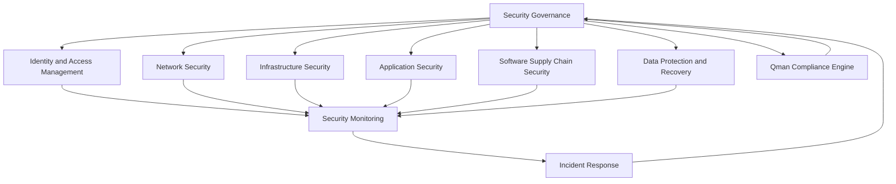

# ADR-005 — Security Architecture

## Metadata

- Decision ID: ADR-005
- Date: 2026-11-24
- Status: Accepted
- Owner: Platform Owner
- Scope: Qman Enterprise Platform
- Classification: Public
- Version: 1.0

## Context

The Qman Enterprise Platform requires a comprehensive,
maintainable and proportionate security architecture.

The platform combines public production services,
development environments, staging environments and
isolated technology experimentation.

Security must be integrated throughout the infrastructure,
application development and operational lifecycle.

The platform must protect infrastructure, identities,
application data, credentials and software supply chains
against unauthorized access, accidental exposure,
configuration errors and malicious activity.

Security controls must be reproducible, measurable,
documented and continuously improved.

The architecture must remain proportionate to the size,
risk profile and operational requirements of the platform.

## Decision

Adopt a defense-in-depth security architecture based on
security by design, least privilege, environment separation
and continuous security validation.

Implement security controls through Infrastructure as Code,
Configuration as Code and automated DevSecOps workflows.

Use identity-based private connectivity for administrative
access and automated deployments.

Establish a reusable Linux security baseline through Ansible.

Implement automated patch management, vulnerability
management, secret scanning, security monitoring and
documented incident response procedures.

Use the Qman Compliance Engine as a foundation for
automated governance and compliance verification.

Security controls must produce verifiable evidence
where technically feasible.

## Security Objectives

The platform must protect:

- Confidentiality
- Integrity
- Availability
- Authenticity
- Accountability
- Recoverability

Security objectives must be translated into measurable
technical and operational controls.

## Architecture Principles

- Security by design
- Secure by default
- Defense in depth
- Zero trust principles
- Least privilege
- Separation of duties
- Separation of trust domains
- Explicit authorization
- Automation first
- Continuous verification
- Controlled public exposure
- Traceable changes
- Verifiable recovery
- Risk-based decision making
- Operational simplicity
- Cost efficiency

Network location alone must not establish trust.

Authentication does not automatically imply authorization.

## Security Reference Frameworks

The platform will use established security frameworks
as guidance.

Initial reference frameworks:

- NIST Cybersecurity Framework
- CIS Controls
- CIS Ubuntu Linux Benchmarks
- OWASP Top 10
- OWASP Application Security Verification Standard
- OWASP Software Component Verification Standard
- Supply-chain Levels for Software Artifacts

Applicable controls will be selected based on platform
requirements and risk exposure.

The platform does not claim formal certification or
complete compliance with these frameworks.

## Security Architecture Overview

## Security Governance

Security governance defines the policies, responsibilities,
standards and verification mechanisms required to operate
the platform securely.

Security governance requirements:

- Documented architectural decisions
- Version-controlled security policies
- Defined security control identifiers
- Documented control ownership
- Automated verification where possible
- Recorded security exceptions
- Periodic security reviews
- Traceable remediation activities
- Documented risk acceptance

Security policies must distinguish between mandatory
requirements, recommendations and future improvements.

Security requirements must be introduced incrementally
without compromising essential production protection.

## Security Responsibilities

| Role | Responsibility |
|------|----------------|
| Platform Owner | Architecture, risk acceptance and governance |
| Platform Engineer | Infrastructure and security implementation |
| Developer | Secure application development |
| Deployment Identity | Authorized automated deployments |
| Compliance Identity | Read-only compliance verification |
| Monitoring Identity | Authorized operational monitoring |
| Backup Identity | Restricted backup operations |

During the initial platform phase, multiple human roles
are performed by the same maintainer.

Workload identities must remain technically separated
even when human responsibilities overlap.

## Trust Domain Separation

Qman and Talland are separate administrative and
security trust domains.

The following resources must remain separated:

- Administrative identities
- GitHub organizations
- Tailscale environments
- Infrastructure inventories
- Infrastructure state
- Application secrets
- Deployment credentials
- Backup repositories
- Monitoring credentials
- Security policies
- Organizational and customer data

Cross-domain access requires explicit organizational
authorization and documented justification.

Qman security policies do not automatically authorize
changes to Talland infrastructure.

## Environment Separation

Environment responsibilities are defined in ADR-002.

### QMAN-01

Production environment.

Security priorities:

- Production availability
- Minimal installed software
- Restricted administrative access
- Stable runtime configuration
- Controlled deployments
- Verified backup and recovery
- Continuous security maintenance

Experimental software must not be installed directly
on QMAN-01.

### QMAN-02

Development, staging and laboratory environment.

Security priorities:

- Isolation between workloads
- Controlled public exposure
- Resource management
- Secure experimentation
- Restricted production connectivity
- Environment-specific credentials

Laboratory workloads must not receive production
credentials or production application data.

Logical separation on shared infrastructure does not
provide the same guarantees as dedicated host isolation.

Privileged experiments must be isolated from staging
or performed when staging is not in use.

## Identity and Access Management

Identity management must ensure that every human and
automated actor receives only the permissions required
for its responsibilities.

Identity categories:

- Human administrative identities
- Human development identities
- Application runtime identities
- Deployment identities
- Compliance identities
- Monitoring identities
- Backup identities

Identity requirements:

- Unique identities where applicable
- Explicit authorization
- Least privilege permissions
- Secure authentication
- Credential rotation
- Periodic access reviews
- Documented identity ownership
- Timely removal of obsolete access

Shared administrative accounts should be avoided.

## Multi-Factor Authentication

Multi-factor authentication is mandatory for human
administrative accounts where supported.

Relevant services include:

- GitHub
- Tailscale identity provider
- VPS providers
- Backblaze B2
- DNS providers
- Administrative email accounts
- Password managers

Phishing-resistant authentication methods should be
preferred where available.

Recovery credentials must be securely stored and
independently accessible.

MFA recovery procedures must be periodically reviewed.

Workload identities must use appropriate non-interactive
authentication instead of human MFA mechanisms.

## Workload Identity Architecture

Automated workloads must use dedicated identities.

Preferred authentication mechanisms:

- GitHub Apps
- OpenID Connect federation
- Short-lived access tokens
- Environment-specific SSH credentials
- Restricted application keys

Long-lived credentials must be minimized.

Workload identities must not use personal administrator
credentials.

Identity permissions must be restricted to the required
resources and operations.

The Qman Compliance Engine will use a dedicated GitHub
App with read-only permissions for compliance verification.

Additional permissions require documented justification.

## GitHub Security

GitHub is the authoritative source for application code,
infrastructure definitions and architectural documentation.

GitHub security requirements:

- Mandatory organization MFA
- Restricted organization ownership
- Least privilege repository permissions
- Controlled repository visibility
- Protected main branches where supported
- Pull request-based changes
- Mandatory CI checks where supported
- Controlled workflow modifications
- Restricted third-party Actions
- Full commit SHA pinning for external Actions
- Read-only workflow permissions by default
- Dependency management
- Secret scanning
- Periodic access reviews

Public repositories must not contain confidential
infrastructure information, credentials or customer data.

Private repositories must not be treated as a substitute
for secure secret storage.

GitHub security controls depend partly on the applicable
personal and organization subscription capabilities.

The Platform Owner uses a GitHub Pro personal account.

Organization subscription levels must be verified
independently before relying on plan-specific controls.

Unsupported security controls require documented
compensating measures where necessary.

## SSH Security

SSH will provide authorized host-level administration
and deployment connectivity.

SSH security requirements:

- Public key authentication
- Restricted administrative access
- No direct remote root login
- No password-based SSH authentication
- Verified SSH host identities
- Environment-specific deployment credentials
- Secure private key storage
- Restricted private key permissions
- Removal of obsolete authorized keys

ED25519 keys are preferred where supported.

Human SSH credentials should be protected with a
passphrase or suitable hardware-backed authentication.

Automated SSH identities must use restricted access
permissions and secure credential storage.

SSH host key verification must not be disabled.

SSH configuration changes must be validated before
service reload.

A verified administrative session and independent
provider console access must be available before
restrictive SSH changes are activated.

## Privilege Management

Administrative users may receive controlled sudo access.

Application runtime users must not have administrative
permissions.

Deployment accounts must only receive narrowly scoped
permissions required for application deployment.

Privileged scripts must be owned by root and protected
against modification by unprivileged users.

Privilege management requirements:

- No unnecessary sudo permissions
- No unrestricted deployment sudo access
- Restricted service management permissions
- Auditable privileged operations
- Separation of runtime and deployment accounts
- Periodic privilege reviews

Access to the Docker socket or membership of the Docker
group must be treated as effectively privileged host access.

## Network Security

Network architecture is defined in ADR-003.

Tailscale will provide identity-based private connectivity
for administrative access and automated deployments.

Both QMAN-01 and QMAN-02 may expose approved public
web services through TCP ports 80 and 443.

Administrative services, databases and internal
application interfaces must remain private.

Network security controls:

- Provider firewalls where supported
- Linux host firewalls
- Tailscale Grants
- Restricted application bindings
- Controlled reverse proxy configuration
- TLS encryption
- IPv4 and IPv6 exposure verification
- Environment-specific network identities

Public HTTP and HTTPS exposure does not automatically
authorize every application for public access.

Tailscale network permissions must not be interpreted
as unrestricted host-level authorization.

Access policies must explicitly restrict staging and
laboratory identities from private production services.

## Linux Security Baseline

Ubuntu LTS will be the initial operating system standard.

The Linux security baseline will be implemented through
reusable Ansible roles.

The baseline must include appropriate controls for:

- Operating system updates
- Package management
- SSH configuration
- User management
- Privilege management
- Firewall configuration
- Time synchronization
- Filesystem permissions
- Kernel security settings
- Service configuration
- Logging
- Mandatory access control
- Backup integration
- Security monitoring

Baseline controls must be validated against the installed
operating system version and application requirements.

Security hardening must not blindly apply configuration
settings without evaluating operational consequences.

Applicable CIS Benchmark recommendations will be used
as reference material.

Exceptions must be documented and justified.

## Operating System Hardening

Production servers must use a minimal package footprint.

Hardening requirements:

- Remove unnecessary packages.
- Disable unused services.
- Restrict listening network interfaces.
- Apply appropriate filesystem permissions.
- Use supported operating system versions.
- Maintain secure package repositories.
- Restrict privileged access.
- Configure secure temporary file handling.
- Enable appropriate kernel security protections.
- Review mandatory access control configuration.
- Maintain accurate system time.

AppArmor should remain enabled where supported.

Application compatibility must be verified before
introducing restrictive security profiles.

Kernel and network settings must be compatible with
Tailscale and approved application workloads.

Container-specific kernel requirements must remain
isolated to environments that require them.

## Patch Management

Security patch management is a mandatory operational
responsibility.

The platform will use automated security updates where
appropriate.

Ubuntu unattended-upgrades will provide the initial
automatic operating system security update mechanism.

Patch management must address:

- Operating system packages
- Kernel updates
- Application runtimes
- Web server software
- Application dependencies
- Infrastructure tooling
- Container images where applicable
- Kubernetes components where applicable

Automatic operating system security updates do not
replace application dependency maintenance.

Patch management requirements:

- Supported software versions
- Regular update availability checks
- Automated security updates
- Recorded update failures
- Reboot requirement detection
- Controlled maintenance windows
- Post-update health verification
- Periodic patch compliance reviews

Automatic reboots must not be enabled without an
appropriate maintenance and recovery strategy.

Routine non-security changes should be validated in
staging before production implementation.

Emergency security updates may follow an expedited
and documented change procedure.

## Vulnerability Management

The platform must identify, assess, prioritize and
remediate relevant security vulnerabilities.

Vulnerability management covers:

- Operating system packages
- Application dependencies
- Application runtime versions
- Public web applications
- Container images
- Infrastructure configuration
- Deployment workflows
- Third-party integrations

Vulnerability sources may include:

- Ubuntu Security Notices
- GitHub Security Advisories
- Dependabot alerts
- Ecosystem-specific vulnerability scanners
- National Vulnerability Database
- CISA Known Exploited Vulnerabilities Catalog

Vulnerability severity must not be the sole remediation
criterion.

Prioritization must consider:

- Known exploitation
- Internet exposure
- Exploitability
- Application criticality
- Data sensitivity
- Available mitigations
- Operational impact

Vulnerability findings must be tracked until remediated
or explicitly accepted as a documented security exception.

## Vulnerability Remediation Targets

The following initial remediation targets are proposed:

| Priority | Target |
|----------|--------|
| Actively exploited and relevant | Within 24 hours |
| Critical | Within 72 hours |
| High | Within 7 days |
| Medium | Within 30 days |
| Low | Within 90 days |

These targets are internal operational objectives,
not contractual service-level guarantees.

If a permanent fix is unavailable, temporary mitigation
must be evaluated and documented.

Temporary mitigation may include:

- Restricting service exposure
- Disabling vulnerable functionality
- Applying vendor-recommended mitigations
- Isolating affected workloads
- Suspending affected services

Unresolved high-risk vulnerabilities require explicit
risk acceptance and an assigned review date.

## Vulnerability Scanning

The initial application security toolset may include:

| Ecosystem | Tool |
|-----------|------|
| Node.js | npm audit |
| Python | pip-audit |
| Git repositories | Gitleaks |
| GitHub dependencies | Dependabot |
| Container images | Trivy or equivalent |
| Host security | To be evaluated |

Scanner versions and execution environments must be
controlled.

Vulnerability scan results must be evaluated in the
context of the actual application and infrastructure.

Security scanning must not automatically publish
sensitive operational findings.

Host and network scans must only target infrastructure
for which explicit authorization exists.

## Application Security

Applications must follow secure development practices.

OWASP guidance will be used as an initial reference.

Application security requirements:

- Input validation
- Output encoding where appropriate
- Secure authentication
- Explicit authorization
- Secure session management
- Dependency management
- Safe error handling
- Restricted sensitive information disclosure
- Secure application configuration
- Appropriate security logging
- Protection against common injection attacks
- Protection against unauthorized data access

Public applications must be evaluated for their
specific threat exposure.

Security controls must be proportionate to the
application's functionality and data sensitivity.

## Reverse Proxy Security

Nginx will provide controlled public access to approved
web applications.

Reverse proxy security requirements:

- HTTPS enforcement
- Modern TLS configuration
- Explicit virtual host definitions
- Rejection of unknown virtual hosts
- Restricted administrative endpoints
- Request size limits where appropriate
- Request rate limits where appropriate
- Appropriate security headers
- Secure backend forwarding
- Controlled proxy timeouts
- Access and error logging

Security headers must be selected according to
application compatibility and requirements.

Content Security Policy should be introduced with
appropriate application testing.

HTTP Strict Transport Security must be enabled only
after HTTPS readiness has been verified.

Application runtime ports must not be directly
exposed to the public internet.

## Software Supply Chain Security

Application builds and deployments must protect the
integrity of the software supply chain.

Requirements:

- Version-controlled source code
- Reproducible dependency installation
- Locked dependency versions
- Trusted package repositories
- Controlled build environments
- Restricted CI/CD permissions
- Full commit SHA pinning for external GitHub Actions
- Artifact integrity verification
- Traceable release metadata
- Software Bill of Materials where applicable

Application dependencies must be reviewed and
maintained throughout the software lifecycle.

Release artifacts must not include credentials
or environment-specific secrets.

Artifact checksums must be obtained from a trusted
release context.

Checksums alone do not prove artifact authenticity.

Artifact signing and build provenance will be
introduced where justified and supported.

## DevSecOps

Security verification must be integrated into
continuous integration and deployment workflows.

Initial security gates:

1. Source code validation.
2. Secret scanning.
3. Dependency vulnerability scanning.
4. Application testing.
5. Build validation.
6. Artifact integrity verification.
7. Staging deployment validation.
8. Explicit production authorization.
9. Production health verification.

Security checks must be appropriate to the application.

Failed mandatory security controls must block
release promotion unless a documented and approved
exception exists.

Untrusted pull request workflows must not receive:

- Production credentials
- Deployment credentials
- Private network access
- Privileged workload identities
- Unrestricted repository write permissions

Workflow permissions must be restricted at job level
where practical.

Deployment security architecture is further defined
in ADR-004.

## Secrets Management

Secrets must remain separate from application source
code, infrastructure definitions and public documentation.

Examples of secrets:

- SSH private keys
- API credentials
- Database passwords
- GitHub App private keys
- Tailscale credentials
- Backup application keys
- Restic encryption passwords
- TLS private keys
- Terraform provider credentials
- Application signing keys

Initial secret storage mechanisms:

- Secure password manager
- macOS Keychain where appropriate
- GitHub Actions Secrets
- GitHub Environment Secrets where supported
- Ansible Vault
- Restricted server-side credential files

Secrets management requirements:

- Least privilege access
- Environment-specific secrets
- Secure storage
- Encrypted transport
- Credential rotation
- Documented ownership
- Secure recovery procedures
- No secrets in public repositories
- No secrets in workflow logs
- No secrets in release artifacts

Ansible Vault decryption credentials must be stored
independently from encrypted configuration files.

Plaintext credentials must not be committed to
source control.

## Credential Storage Standard

The engineering workstation may use the following
local credential directory:

    ~/.config/qman/credentials/

Example structure:

    credentials/
        github/
        terraform/
        ansible/
        restic/
        tailscale/

Existing credential locations may remain in use
during the initial transition.

Credential directories should use permission mode 700.

Private credential files should use permission mode 600
or stricter where compatible with the required workload.

Server-side credentials must be accessible only to
the authorized service or administrative identity.

Full disk encryption must be enabled on the
engineering workstation.

Credential files must not be stored inside public
Git repositories.

## Credential Rotation

Credentials must support controlled rotation.

Rotation is required when:

- Credential compromise is suspected.
- Credentials are accidentally exposed.
- Access responsibilities change.
- A workload is decommissioned.
- A credential reaches its defined expiration date.
- A security review identifies unnecessary access.

Short-lived credentials are preferred.

Rotation procedures must verify that the replacement
credential works before the previous credential
is revoked where operationally appropriate.

Compromised credentials must be revoked immediately.

Secret exposure must not be resolved solely by
removing the secret from the latest Git commit.

## Data Classification

The platform will use four initial data classifications.

| Classification | Description |
|----------------|-------------|
| Public | Approved for unrestricted publication |
| Internal | Non-public operational information |
| Confidential | Sensitive business or infrastructure information |
| Restricted | Credentials, private keys and highly sensitive data |

Examples of public information:

- Architecture Decision Records
- Generic Ansible roles
- Generic Terraform modules
- Public application source code
- Sanitized architecture diagrams
- Generic engineering standards

Examples of confidential information:

- Detailed infrastructure inventories
- Security assessment findings
- Detailed access configurations
- Customer information
- Incident investigation records

Examples of restricted information:

- Private keys
- Passwords
- Authentication tokens
- Backup encryption credentials
- Sensitive database exports
- Secret-bearing infrastructure state

Information must be classified according to its
actual contents rather than its filename or
repository visibility.

Customer and personal data must be handled according
to applicable legal, contractual and organizational
requirements.

## Infrastructure State Security

Terraform state may contain sensitive infrastructure
information and secret values.

Infrastructure state must never be committed to a
public Git repository.

Terraform state requirements:

- Restricted access
- Encryption at rest where supported
- Encrypted transport
- Environment separation
- Controlled concurrent operations
- Backup and recovery procedures
- Version recovery where supported

Terraform plan files must receive equivalent protection
when they contain sensitive values.

Marking Terraform variables as sensitive does not
automatically remove their values from state.

The final state backend and locking strategy will
be defined during the Terraform implementation phase.

No additional cloud platform will be introduced
solely for Terraform state without a documented
architectural justification.

## Backup and Data Protection

Backup architecture is defined in ADR-001.

Restic and Backblaze B2 provide the foundation for
encrypted offsite backups.

Backup security requirements:

- Private backup storage
- Client-side encryption
- Encrypted transport
- Dedicated application credentials
- Environment-specific backup access
- Independent recovery password storage
- Repository integrity verification
- Periodic restore testing
- Controlled retention
- Monitoring of backup failures

Backup credentials must not provide unnecessary
access to unrelated repositories.

Backup deletion protection and immutability must
be evaluated and validated.

Successful backup creation alone does not establish
successful recoverability.

The initial synthetic-data backup and restore test
has been completed.

Production backup coverage and automated recovery
procedures require further implementation.

## Logging and Audit Trail

The platform must maintain sufficient operational
and security logging.

Initial log sources:

- Systemd journal
- SSH authentication events
- Sudo events
- Nginx access logs
- Nginx error logs
- Application logs
- Firewall events
- Package management logs
- Backup execution logs
- Deployment workflow logs
- GitHub audit events where available
- Tailscale administrative events where available

Logs must support incident investigation and
operational troubleshooting.

Logging requirements:

- Accurate timestamps
- Consistent time synchronization
- Appropriate access restrictions
- Defined retention
- Protection against unnecessary secret disclosure
- Protection against unauthorized modification
- Monitoring of important security events

Logs may contain personal or confidential information
and must be handled accordingly.

Centralized logging will be introduced when supported
by operational requirements.

## Security Monitoring

Security monitoring must progressively identify
unexpected or unauthorized platform activity.

Initial monitoring objectives:

- Unexpected public listening ports
- Failed authentication attempts
- Unauthorized administrative access
- Unexpected privilege changes
- Firewall configuration drift
- Missing security updates
- Unsupported software versions
- Vulnerability findings
- Failed backup operations
- Failed integrity checks
- Certificate expiration
- Unexpected deployment activity
- Security compliance failures

Monitoring must produce actionable findings.

Alerting must avoid unnecessary noise while ensuring
important security failures receive attention.

Monitoring components must use dedicated read-only
identities wherever possible.

Monitoring endpoints must remain private unless
explicitly authorized.

## Automated Compliance Verification

The Qman Compliance Engine provides the foundation
for automated governance verification.

Compliance verification should progressively cover:

- GitHub organization security
- Repository governance
- Workflow permissions
- Identity and access management
- SSH configuration
- Firewall configuration
- Public network exposure
- Operating system security baseline
- Patch compliance
- Backup status
- Deployment security
- Configuration drift

Each automated control should define:

- Unique control identifier
- Control description
- Expected configuration
- Verification method
- Applicable environment
- Security rationale
- Severity
- Remediation guidance
- Evidence requirements

Initial compliance result categories:

- PASS
- WARN
- FAIL
- ERROR
- NOT_APPLICABLE

A verification error must not be interpreted as
a successful control result.

Future control implementation must extend the
existing result model consistently.

Compliance checks should be read-only by default.

Automatic remediation must be separately authorized
and implemented through controlled configuration
management.

## Compliance Evidence

Security controls must produce verifiable evidence
where technically feasible.

Evidence may include:

- Automated compliance reports
- Configuration validation results
- CI/CD workflow results
- Security scan summaries
- Access review records
- Backup verification results
- Restore test results
- Incident investigation records
- Approved security exceptions

Evidence must be protected according to its
data classification.

Detailed findings must not be automatically
published in public repositories.

Sanitized summaries may be published as part of
the public platform showcase.

## Security Exception Management

Security exceptions must be documented when a
mandatory security requirement cannot be met.

Each exception must include:

- Exception identifier
- Related security control
- Description of the deviation
- Reason for the exception
- Security risk
- Compensating controls
- Responsible owner
- Approval status
- Approval date
- Expiration or review date
- Remediation plan where applicable

Exceptions must be time-bound or periodically reviewed.

Security exceptions must not silently disable
compliance verification.

The existing Qman Compliance Engine exception
mechanism will remain the initial reference
implementation.

## Incident Response

The platform must maintain documented procedures
for responding to security incidents.

Initial incident response lifecycle:

1. Preparation.
2. Detection.
3. Assessment.
4. Containment.
5. Evidence preservation.
6. Eradication.
7. Recovery.
8. Post-incident review.

Incident response must prioritize limiting damage,
protecting data and restoring trusted operations.

Potential security incidents include:

- Credential compromise
- Unauthorized server access
- Secret exposure
- Malicious dependency updates
- Compromised deployment workflows
- Unexpected public service exposure
- Application compromise
- Backup compromise
- Data loss
- Unauthorized configuration changes

Incident response procedures must be documented
as operational runbooks.

## Incident Severity

The following initial incident classification model
will be used.

| Severity | Description |
|----------|-------------|
| SEV-1 | Critical compromise or major production impact |
| SEV-2 | Significant security or service impact |
| SEV-3 | Limited impact requiring investigation |
| SEV-4 | Minor security event or observation |

Incident severity must be based on actual impact,
data sensitivity, scope and urgency.

Incident severity may change as additional
information becomes available.

## Incident Recovery

Recovery from a security incident must establish
a trusted operational state.

Recovery may require:

- Revocation of compromised credentials
- Credential rotation
- Isolation of affected systems
- Restoration of validated configurations
- Application rollback
- Infrastructure reprovisioning
- Restoration from verified backups
- Validation of system integrity
- Additional monitoring

A potentially compromised server must not be
considered trustworthy merely because suspicious
files have been removed.

Rebuilding infrastructure from trusted automation
is preferred when host integrity cannot be established.

Relevant evidence must be preserved before
destructive recovery operations where appropriate.

## Emergency Access

Emergency administrative access must remain
available independently of normal private
network connectivity.

Emergency access requirements:

- Verified VPS provider console access
- Secure provider account recovery
- Multi-factor authentication
- Independently accessible recovery information
- Documented firewall recovery procedures
- Documented SSH recovery procedures
- Documented Tailscale recovery procedures

Emergency access must not introduce a permanently
exposed administrative service.

Emergency access procedures must be periodically
tested.

## Workstation Security

The engineering workstation is a privileged
administrative environment.

Workstation security requirements:

- Full disk encryption
- Supported operating system version
- Regular security updates
- Secure screen locking
- Multi-factor authentication
- Restricted SSH private key permissions
- Secure password manager
- Secure credential storage
- Controlled software installation
- Regular backup of important local data

Administrative credentials must not be exposed to
untrusted development tools or experimental workloads.

Laboratory tooling must not receive unrestricted
access to production credentials.

The workstation must not become a runtime dependency
for production services.

## Container Security

Container technology will initially be introduced
within QMAN-02.

Container security requirements:

- Trusted base images
- Controlled image versions
- Immutable image digests where appropriate
- Image vulnerability scanning
- Minimal container images
- Non-root runtime where supported
- Restricted Linux capabilities
- No unnecessary privileged containers
- Controlled filesystem mounts
- Resource limits
- Restricted network exposure
- Secure secret injection

The Docker socket must not be exposed to untrusted
applications.

Container isolation must not be treated as a complete
security boundary against privileged workloads.

Published container ports must be independently
verified against the intended network policy.

## Kubernetes Security

Kubernetes will initially remain an isolated
laboratory technology.

Before Kubernetes workloads are introduced, the
following requirements must be evaluated:

- Kubernetes API authentication
- Role-based access control
- Namespace isolation
- Pod Security Standards
- Network policies
- Resource quotas
- Secret management
- Audit logging
- Image security
- Admission controls
- Controlled ingress
- Cluster upgrade procedures
- Backup and recovery

Network policy enforcement depends on the selected
networking implementation.

Kubernetes Secrets must not be treated as encrypted
merely because their values are base64 encoded.

Laboratory clusters must not receive production
credentials or unrestricted production connectivity.

Production Kubernetes adoption requires a separate
architectural decision.

## Threat Model

The platform threat model must be reviewed as
infrastructure and application functionality evolve.

Initial threat scenarios:

| Threat | Primary Controls |
|--------|------------------|
| Unauthorized public access | Firewalls and restricted service exposure |
| Credential theft | MFA and secure credential storage |
| Compromised CI workflow | Least privilege and isolated jobs |
| Malicious dependencies | Dependency scanning and controlled builds |
| Secret leakage | Secret scanning and credential separation |
| Vulnerable public applications | Patching and application security |
| Compromised lab workload | Environment and network isolation |
| Unauthorized production deployment | Dedicated identities and authorization |
| Configuration drift | Ansible and compliance verification |
| Backup destruction | Restricted access and deletion protection |
| Data loss | Encrypted backups and recovery testing |
| Administrator lockout | Independent emergency access |
| Resource exhaustion | Monitoring and resource controls |

Threat models must identify relevant assets,
trust boundaries and security assumptions.

New public services must receive an appropriate
security review before deployment.

## Change Management

Infrastructure and security changes must be traceable.

The preferred change process:

1. Define the change.
2. Assess operational and security impact.
3. Update version-controlled configuration.
4. Validate the configuration.
5. Test in non-production where applicable.
6. Authorize the production change.
7. Apply the change.
8. Verify the result.
9. Record evidence and update documentation.

Emergency changes may follow an expedited process.

Emergency changes must subsequently be documented
and reconciled with source-controlled configuration.

Destructive infrastructure operations require
explicit authorization.

Required production and customer data must be
reviewed and protected before infrastructure
is destroyed or reinstalled.

## Security Metrics

The platform should progressively establish
measurable security indicators.

Initial proposed metrics:

| Metric | Initial Objective |
|--------|-------------------|
| Administrative MFA coverage | 100% |
| Authorized public service exposure | 100% |
| Security baseline coverage | 100% of in-scope production hosts |
| Dedicated workload identity coverage | 100% of privileged workloads |
| Critical vulnerability remediation | Within defined targets |
| Production backup success | According to backup policy |
| Recovery test completion | According to recovery policy |
| Mandatory compliance control status | No unaccepted failures |
| Expired security exceptions | Zero |
| Confirmed secret exposures | Zero |

Metrics must distinguish between verified results,
unknown results and accepted exceptions.

Measurement methods and reporting periods must
be documented before metrics are used to assess
security performance.

## Security Testing

Security testing must verify that implemented
controls operate as intended.

Initial security tests:

- Public port exposure verification
- Private SSH connectivity verification
- Unauthorized access rejection
- Cross-environment access rejection
- Deployment identity permission verification
- Firewall policy validation
- Application health verification
- Secret scanning validation
- Dependency scanning validation
- Backup integrity verification
- Backup recovery verification
- Security baseline verification

Security testing must be authorized and must
not affect unrelated infrastructure.

Production security testing must consider
service availability and operational impact.

## Cost Management

Security tooling must remain proportionate to
the platform's size and risk profile.

Initial cost management principles:

- Prefer established open-source tooling.
- Reuse existing infrastructure.
- Use available GitHub security capabilities.
- Avoid unnecessary external security platforms.
- Introduce paid tools only when justified.
- Monitor backup and artifact storage costs.
- Evaluate maintenance effort as an operational cost.

A complex security architecture is not inherently
more secure than a smaller, well-maintained one.

Security tooling must provide measurable
operational value.

## Alternatives Considered

### Manual Security Management

Advantages:

- Low initial implementation effort
- Limited tooling requirements

Disadvantages:

- Inconsistent configuration
- Increased human error
- Limited auditability
- Configuration drift
- Difficult repeatability

Decision: Not selected.

### Dedicated Enterprise Security Platforms

Examples:

- Commercial SIEM
- Commercial endpoint detection platforms
- Enterprise secret management platforms
- Managed vulnerability management platforms

Advantages:

- Advanced security capabilities
- Centralized management
- Extended reporting and integrations

Disadvantages:

- Additional licensing costs
- Additional infrastructure requirements
- Increased operational complexity

Decision: Deferred until justified by platform
growth or security requirements.

### Perimeter-Only Security

Advantages:

- Simple initial network configuration
- Limited identity management requirements

Disadvantages:

- Excessive trust in internal networks
- Limited protection against compromised workloads
- Weak environment isolation

Decision: Not selected.

### Automated Defense-in-Depth Security

Advantages:

- Reproducible security controls
- Multiple independent protection layers
- Traceable configuration
- Continuous verification
- Incremental implementation
- Appropriate operational scalability

Disadvantages:

- Initial automation development effort
- Ongoing maintenance requirements
- Requires validation of automated controls

Decision: Selected.

## Known Risks

| Risk | Mitigation |
|------|------------|
| Single platform maintainer | Explicit authorization and documented changes |
| Compromised administrative workstation | Disk encryption, MFA and restricted credentials |
| Compromised GitHub workflow | SHA pinning, limited permissions and isolated jobs |
| Public staging vulnerabilities | Controlled exposure and security maintenance |
| Shared staging and lab infrastructure | Isolation and resource restrictions |
| Long-lived workload credentials | Scoped access and progressive federation |
| Unsupported subscription features | Documented compensating controls |
| Accidental administrator lockout | Verified emergency console access |
| Failed automatic updates | Monitoring and controlled recovery procedures |
| Delayed vulnerability remediation | Defined remediation targets and alerts |
| Backup credential compromise | Restricted access and deletion protection |
| Loss of recovery credentials | Independent secure credential storage |
| Configuration drift | Ansible and automated compliance verification |
| Incomplete security visibility | Incremental monitoring implementation |
| External provider dependency | Documented recovery and exit procedures |
| Excessive operational complexity | Proportionate controls and periodic reviews |

## Current Limitations

- The target infrastructure has not yet been rebuilt.
- The reusable Linux security baseline is not yet
  implemented.
- Target Tailscale Grants are not yet configured
  and validated.
- Existing trust domain separation requires verification.
- Workload identity federation is not yet operational.
- Environment-specific deployment identities are not
  yet implemented.
- The Terraform state backend is not yet selected.
- Automated host vulnerability scanning is not yet
  implemented.
- Patch compliance monitoring is not yet operational.
- Production backup automation is not yet implemented.
- Backup immutability is not yet validated.
- Central security monitoring is not yet operational.
- Incident response runbooks are not yet established.
- Independent four-eyes authorization is not currently
  achievable.
- Organization subscription capabilities require
  verification.
- Container and Kubernetes isolation are not yet
  implemented.
- Automated compliance verification currently covers
  only the implemented control scope.

These limitations must be tracked and addressed
during the appropriate implementation phases.

Acceptance of this ADR does not establish that
all security controls are operational.

## Implementation Roadmap

### Phase 1 — Governance and Architecture

1. Establish security architecture.
2. Define security control identifiers.
3. Establish data classification.
4. Document security risks and exceptions.

### Phase 2 — Identity and Network Security

5. Verify administrative MFA.
6. Inventory administrative identities.
7. Validate trust domain separation.
8. Configure Tailscale network identities.
9. Implement restricted network grants.
10. Establish emergency recovery access.
11. Implement dedicated workload identities.

### Phase 3 — Infrastructure Security

12. Establish secure Terraform operations.
13. Implement the Ansible security baseline.
14. Configure secure SSH access.
15. Implement host firewall policies.
16. Configure automated security updates.
17. Validate operating system hardening.
18. Establish patch compliance checks.

### Phase 4 — Application and Deployment Security

19. Implement DevSecOps workflows.
20. Implement vulnerability scanning.
21. Implement dedicated deployment identities.
22. Validate artifact integrity.
23. Validate staging and production isolation.
24. Test deployment authorization and rollback.

### Phase 5 — Data Protection and Observability

25. Implement automated production backups.
26. Validate production recovery.
27. Evaluate backup deletion protection.
28. Implement security monitoring.
29. Establish alerting.
30. Extend automated compliance verification.
31. Establish incident response runbooks.

### Phase 6 — Advanced Platform Security

32. Establish isolated container workloads.
33. Implement container security controls.
34. Evaluate Kubernetes security controls.
35. Evaluate software supply chain provenance.
36. Conduct periodic security architecture reviews.

## Acceptance Criteria

- [ ] Security architecture documented.
- [ ] Security control ownership defined.
- [ ] Data classification established.
- [ ] Qman and Talland trust domains separated.
- [ ] Administrative MFA verified.
- [ ] Administrative identities reviewed.
- [ ] Dedicated workload identities implemented.
- [ ] Least privilege access validated.
- [ ] Secure SSH baseline implemented.
- [ ] Emergency console access verified.
- [ ] Public SSH access disabled.
- [ ] Approved public network exposure verified.
- [ ] Tailscale Grants implemented and tested.
- [ ] Linux security baseline implemented.
- [ ] Security baseline managed through Ansible.
- [ ] Operating system security updates automated.
- [ ] Patch compliance monitoring implemented.
- [ ] Vulnerability management process established.
- [ ] Dependency vulnerability scanning implemented.
- [ ] Secret scanning implemented.
- [ ] Secure credential storage validated.
- [ ] Environment-specific credentials established.
- [ ] Terraform state adequately protected.
- [ ] Deployment authorization validated.
- [ ] Release artifact integrity verified.
- [ ] Production backup procedures implemented.
- [ ] Production recovery procedures tested.
- [ ] Backup deletion protection evaluated.
- [ ] Security logging operational.
- [ ] Security monitoring operational.
- [ ] Security alerting operational.
- [ ] Automated compliance verification established.
- [ ] Security exception management operational.
- [ ] Incident response runbooks established.
- [ ] Security testing procedures established.
- [ ] Applicable container security controls validated.
- [ ] Applicable Kubernetes security controls validated.

Container and Kubernetes acceptance criteria become
applicable when those technologies are introduced.

Security control acceptance must be supported by
appropriate verification evidence.

## Consequences

The selected security architecture establishes a
consistent foundation for securing the Qman
Enterprise Platform.

Security becomes an integral part of infrastructure
provisioning, configuration management, application
development and operational maintenance.

Automated security controls improve repeatability,
traceability and operational consistency.

The architecture requires an initial investment in
automation, documentation and validation.

Ongoing security maintenance remains necessary
throughout the platform lifecycle.

The platform will progressively increase its
security maturity without introducing unnecessary
services or disproportionate operational complexity.

Security effectiveness must be demonstrated through
continuous verification rather than architectural
documentation alone.

## Review Policy

Review this decision:

- Quarterly
- After a security incident
- After significant infrastructure changes
- After significant identity or access changes
- Before introducing customer production workloads
- Before introducing new public services
- Before introducing container orchestration
- When regulatory or contractual requirements change
- When security tooling requirements change
- When significant new threats are identified

## Related Architecture Decision Records

- ADR-001 — Backup Storage Architecture
- ADR-002 — Environment Separation
- ADR-003 — Network Architecture
- ADR-004 — Deployment Architecture

## References

- https://www.nist.gov/cyberframework
- https://www.cisecurity.org/controls
- https://www.cisecurity.org/cis-benchmarks
- https://owasp.org/
- https://owasp.org/www-project-application-security-verification-standard/
- https://slsa.dev/
- https://documentation.ubuntu.com/server/
- https://ubuntu.com/security/notices
- https://www.cisa.gov/known-exploited-vulnerabilities-catalog
- https://docs.github.com/en/code-security
- https://tailscale.com/docs/
- https://docs.ansible.com/
- https://restic.readthedocs.io/
- https://kubernetes.io/docs/concepts/security/
- https://github.com/Qman-Nexus/qman-compliance-engine

## Revision History

| Version | Date | Description |
|---------|------|-------------|
| 1.0 | 2026-11-24 | Initial security architecture decision |

---

Qman Enterprise Platform

Secure by design. Automated by default.

